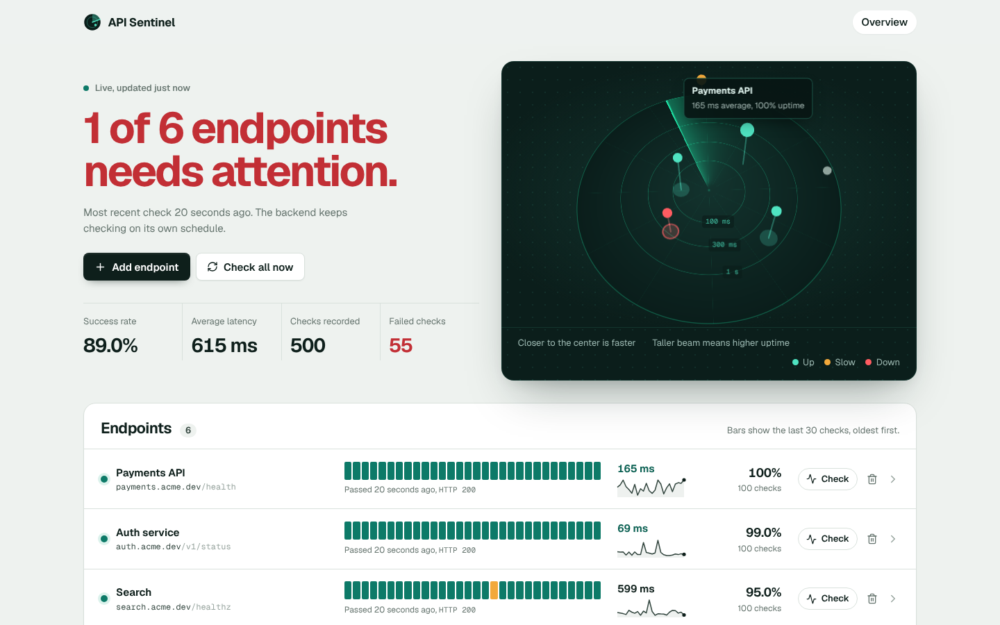
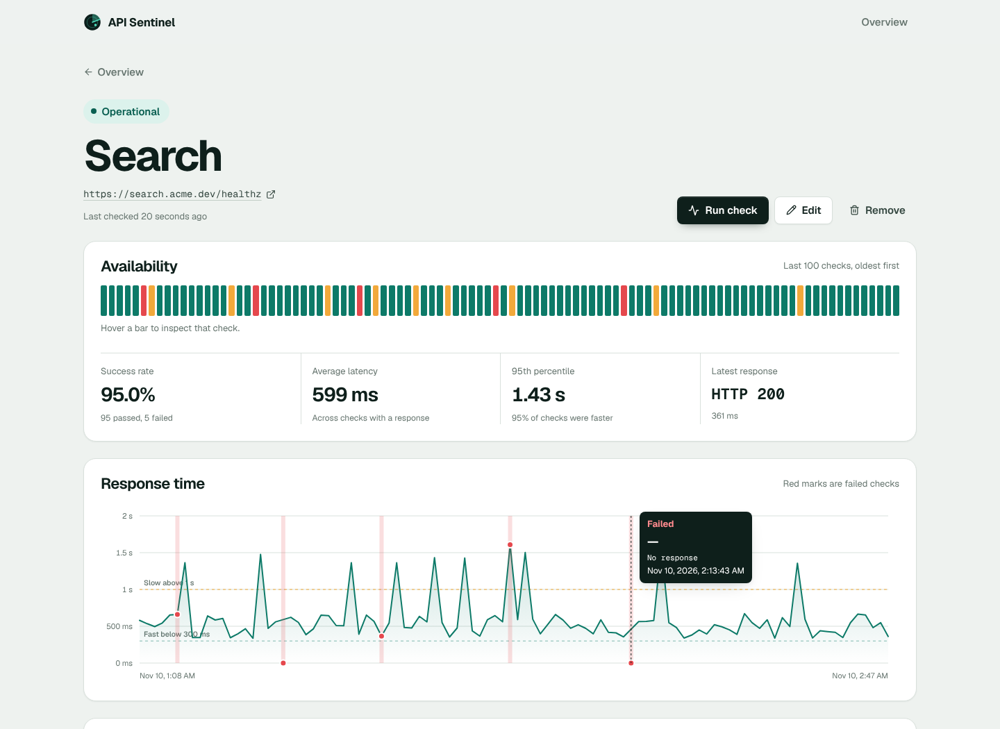
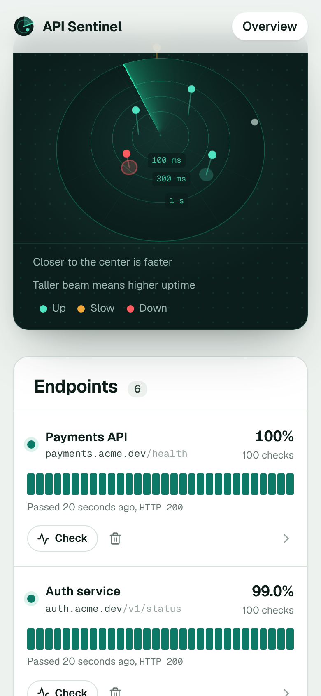

# API Sentinel

API Sentinel is a portfolio project for monitoring HTTP APIs from a clean web dashboard. It lets a user register API endpoints, run checks on demand, review the latest status, inspect response time history, and remove endpoints that are no longer monitored.

The project was built as a CS50x final project and evolved into a full-stack demo with a React frontend, a FastAPI backend, SQLite persistence, API validation, check history, and automated backend tests.

## Links

- **Live Demo:** [api-sentinel-pi.vercel.app](https://api-sentinel-pi.vercel.app)
- **Backend/API Docs:** [api-sentinel-backend-5w2w.onrender.com/docs](https://api-sentinel-backend-5w2w.onrender.com/docs)
- **Backend Health Check:** [api-sentinel-backend-5w2w.onrender.com/health](https://api-sentinel-backend-5w2w.onrender.com/health)
- **GitHub Repository:** [github.com/paulo-sempio-neto/api-sentinel](https://github.com/paulo-sempio-neto/api-sentinel)
- **CS50x Certificate:** Available on request.

## Features

- Register API endpoints with a name and HTTP/HTTPS URL.
- See every endpoint on a live 3D latency radar: distance from the center is
  average latency, beam height is uptime and color is the current status.
- Read a status-page style overview with a plain-language headline, fleet
  vitals and a 30-check uptime strip and latency sparkline per endpoint.
- Keep data fresh automatically: the dashboard re-reads results every 30 seconds
  while the tab is visible, without starting extra checks.
- Run manual health checks from the dashboard, one at a time or all at once.
- Show current status as `Operational`, `Issue detected`, or `Not checked`.
- Display status code, response time, last check time, and recent check history.
- View a dedicated endpoint detail page with a 100-check availability strip you can
  inspect bar by bar, success rate, average and 95th-percentile latency, an
  interactive response-time chart and a filterable check log.
- Add and edit endpoints in a side drawer; delete them through an accessible
  confirmation dialog.
- Handle duplicate URLs, validation errors, backend connection errors, and loading states.
- Expose a documented JSON API through FastAPI/OpenAPI.

## Screenshots

<p align="center">
  
</p>

<table>
  <tr>
    <td></td>
    <td align="center" width="32%"></td>
  </tr>
</table>

### Frontend design notes

- **Latency radar.** Built with React Three Fiber. The sweep is a single fragment
  shader; each endpoint is placed on a log scale (20 ms at the center, 5 s at the
  rim). Hovering a blip shows its numbers and clicking opens its detail page.
  Rendering pauses when the radar scrolls out of view, the 3D engine loads only
  on the overview, and the page falls back to the list if WebGL is unavailable.
- **Accessible by default.** Overlays trap focus, close with `Esc` and return
  focus; the whole row is a single link target; charts carry text alternatives;
  `prefers-reduced-motion` stops the sweep and entrance animations.
- **Type.** Geist for the interface and Geist Mono only for real code values
  such as URLs and HTTP status codes.

## Tech Stack

| Layer | Technologies |
| --- | --- |
| Frontend | React, TypeScript, Vite, React Router, React Three Fiber (Three.js), Motion, Lucide, CSS |
| Backend | Python, FastAPI, Pydantic, Uvicorn |
| Database | SQLite |
| HTTP checks | HTTPX |
| Testing | pytest, FastAPI TestClient |
| Deployment | Vercel for frontend, Render for backend |

## Backend Highlights

- FastAPI route layer with typed request and response models.
- SQLite schema with endpoint records and check history.
- Manual check workflow with persisted status code, latency, timestamp, and error message.
- Duplicate URL handling, validation errors, and clear API responses.
- Offline pytest suite with temporary databases and blocked real outbound HTTP.

## Architecture

```text
Browser
  -> Vercel static React frontend
  -> FastAPI backend on Render
  -> SQLite database
```

The frontend lives in `api-sentinel-starter/frontend` and communicates with the backend through the existing API routes. In production, Vite embeds the backend URL through `VITE_API_BASE_URL`.

The backend lives in `api-sentinel-starter`. It defines FastAPI routes, validates request payloads with Pydantic, persists endpoints and check results in SQLite, and exposes both legacy routes and `/api/v1` routes.

SQLite stores two core resources:

- `endpoints`: monitored API name and URL.
- `checks`: persisted check results with success, status code, latency, timestamp, and error message.

## API Overview

The frontend uses the existing backend API:

| Method | Route | Purpose |
| --- | --- | --- |
| `GET` | `/health` | Backend health check |
| `GET` | `/endpoints` | List monitored endpoints |
| `POST` | `/endpoints` | Create an endpoint |
| `PUT` | `/endpoints/{endpoint_id}` | Update an endpoint |
| `DELETE` | `/endpoints/{endpoint_id}` | Delete an endpoint |
| `POST` | `/endpoints/{endpoint_id}/check` | Run a manual check |
| `GET` | `/endpoints/{endpoint_id}/checks` | Read check history |

The same contract is also available under `/api/v1`.

## Run Locally

### 1. Clone the repository

```powershell
git clone https://github.com/paulo-sempio-neto/api-sentinel.git
cd api-sentinel
```

### 2. Start the backend

```powershell
cd api-sentinel-starter
py -m venv .venv
.\.venv\Scripts\Activate.ps1
python -m pip install -r requirements.txt
python -m uvicorn app:app --reload --host 127.0.0.1 --port 8000
```

Backend URLs:

- API health: <http://127.0.0.1:8000/health>
- OpenAPI docs: <http://127.0.0.1:8000/docs>

### 3. Start the frontend

Open another terminal:

```powershell
cd api-sentinel-starter/frontend
npm install
npm run dev
```

The Vite dev server will print the local frontend URL, usually:

```text
http://127.0.0.1:5173
```

During local development, Vite proxies `/api` requests to the FastAPI backend.

## Build Frontend

```powershell
cd api-sentinel-starter/frontend
npm run build
```

This runs TypeScript checks and creates the production frontend bundle in `dist`.

## Run Tests

From `api-sentinel-starter`:

```powershell
python -m pytest
```

The test suite uses temporary SQLite databases and blocks real outbound HTTP calls, keeping tests deterministic.

## Deployment Notes

The current public deployment uses:

- Vercel for the React/Vite frontend.
- Render for the FastAPI backend.
- CORS configured to allow the Vercel frontend origin.

For the deployed frontend, configure:

```text
VITE_API_BASE_URL=https://api-sentinel-backend-5w2w.onrender.com
```

The backend exposes `/health`, which Render uses as its health endpoint.

## Portfolio Notes

This project demonstrates:

- full-stack API integration;
- typed frontend development with React and TypeScript;
- REST API design with FastAPI;
- SQLite persistence;
- frontend loading, empty, error, and success states;
- production deployment across Vercel and Render;
- automated tests for backend behavior.

It is intentionally scoped as a portfolio/demo application. Authentication, user accounts, alert notifications, and a production-grade database are natural future improvements.
